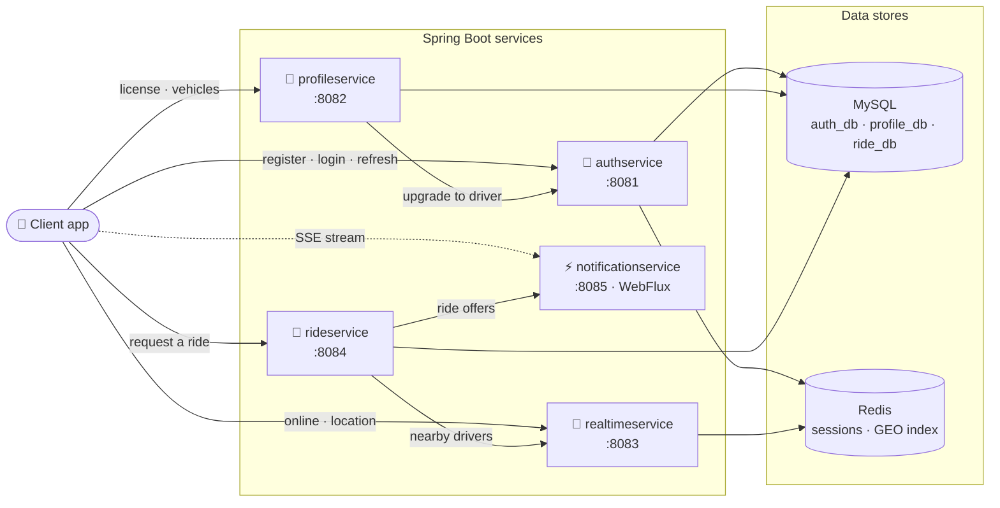
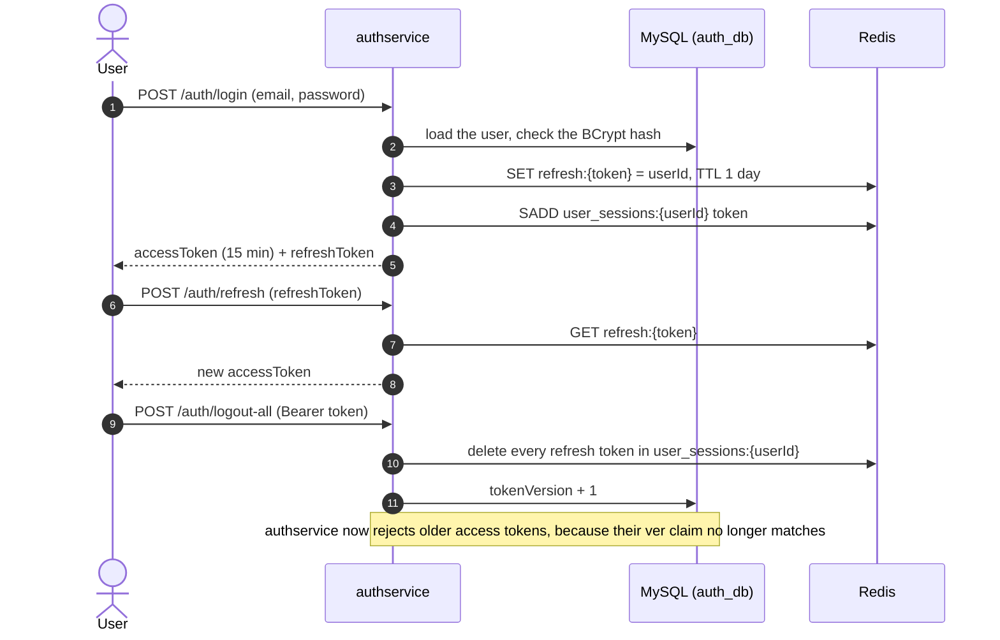
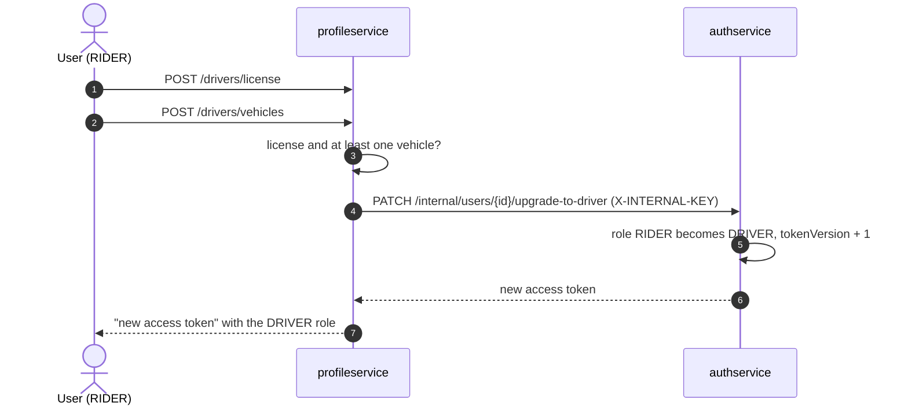
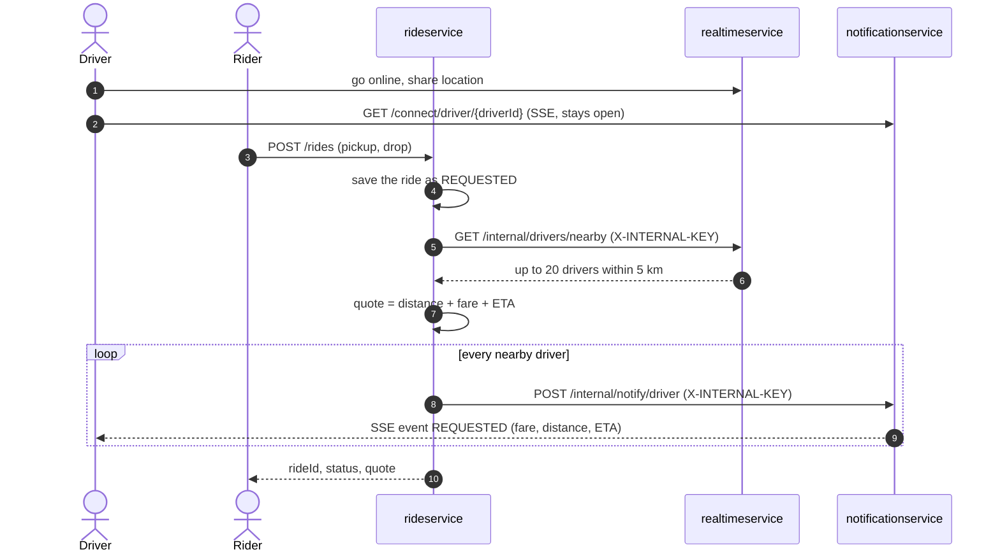
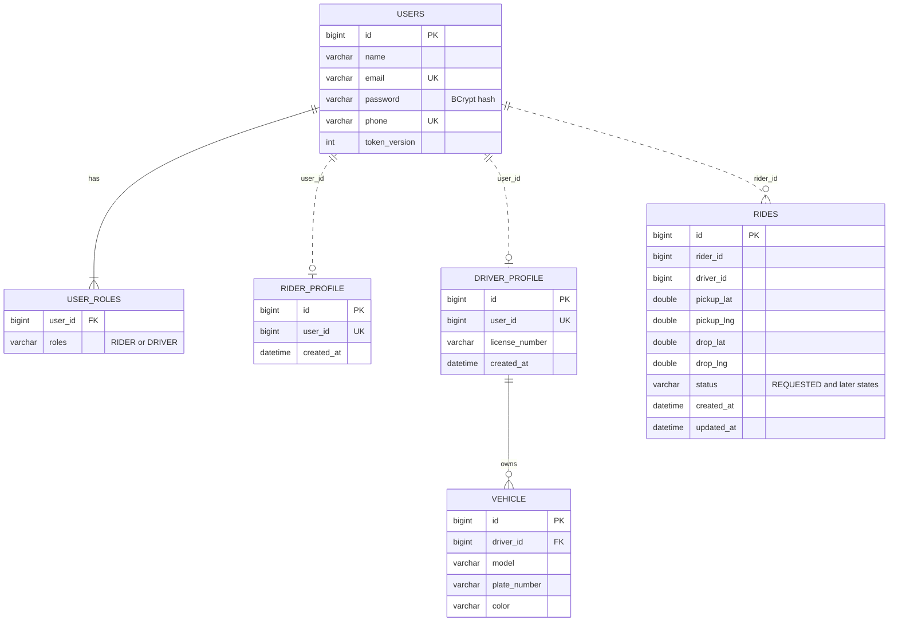

<div align="center">

# 🚕 Ryde

**A ride-sharing backend built as five Spring Boot microservices**

JWT sessions backed by Redis · nearby-driver search with Redis GEO · instant fare quotes · live ride offers over Server-Sent Events

<br/>


<br/>


<br/>

[Features](#-features) •
[Architecture](#%EF%B8%8F-architecture) •
[How it works](#-how-it-works) •
[API](#-api-reference) •
[Run locally](#-run-locally) •
[Try it](#-try-it) •
[Tests](#-tests) •
[Roadmap](#%EF%B8%8F-roadmap)

</div>

---

## 📖 Overview

Ryde is the backend of a ride-hailing app, split by business capability into five independently runnable Spring Boot services.

- **Riders** sign up, request a trip and get an instant quote with distance, fare and ETA.
- **Drivers** start as riders, add a license and a vehicle to get upgraded, then go online and share a live location.
- **Ride offers** reach every driver within 5 km as soon as a trip is requested, over a Server-Sent Events stream.

The project focuses on the parts of a microservice backend that are easy to get wrong: stateless JWT security with a working logout, token lifecycles, service-to-service calls behind a shared internal key, geospatial search and reactive streaming.

## ✨ Features

| | Feature | How it works |
|:-:|---|---|
| 🔐 | **Stateless auth with real logout** | Access tokens are 15-minute HS256 JWTs carrying `userId`, `roles` and a token version. Refresh tokens are opaque, stored in Redis for 1 day. Logout revokes one session, logout-all revokes every session, and both invalidate older access tokens. |
| 🚗 | **Rider to driver upgrade** | When a profile has a license and at least one vehicle, the profile service calls the auth service. The role switches from `RIDER` to `DRIVER`, and the user gets a fresh token. |
| 📍 | **Nearby-driver search** | Online drivers' positions live in a Redis GEO index. One `GEOSEARCH` returns up to 20 drivers within 5 km, nearest first. |
| 💰 | **Instant quotes** | Haversine distance, fare = (50 + 15 × km) × surge, and ETA at 30 km/h. Each calculator sits behind an interface, so pricing rules can change without touching the ride flow. |
| ⚡ | **Live ride offers** | A reactive WebFlux service keeps one Server-Sent Events stream per rider and driver, and pushes every new ride request to each nearby driver. |
| 🛡️ | **Locked-down internal APIs** | Every service validates JWTs itself. `/internal/**` endpoints need a shared `X-INTERNAL-KEY`. Role checks use `@PreAuthorize`, and a token can only open its owner's stream. |

## 🏗️ Architecture



| Service | Port | Built with | Responsibility | Storage |
|---|:-:|---|---|---|
| `authservice` | 8081 | Spring MVC, Security, Data JPA, Data Redis | Register, login, refresh, logout, logout-all. Issues JWTs. Internal role upgrade | MySQL `auth_db`, Redis |
| `profileservice` | 8082 | Spring MVC, Security, Data JPA, WebClient | Rider and driver profiles, license and vehicles. Triggers the driver upgrade | MySQL `profile_db` |
| `realtimeservice` | 8083 | Spring MVC, Security, Data Redis | Online and offline drivers, live locations, nearby-driver search | Redis |
| `rideservice` | 8084 | Spring MVC, Security, Data JPA, WebClient | Ride requests, quotes, driver notifications | MySQL `ride_db` |
| `notificationservice` | 8085 | Spring WebFlux, Security, Reactor | SSE streams for riders and drivers | In-memory Reactor sinks |

### 🧰 Tech stack

| Area | Technologies |
|---|---|
| Language and framework | Java 21, Spring Boot 3.2.5, Maven multi-module build |
| Security | Spring Security 6, JJWT (HS256), BCrypt |
| Data | Spring Data JPA and Hibernate on MySQL 8, Spring Data Redis (keys with TTL, sets, GEO) |
| Communication | WebClient between services, Spring WebFlux and Project Reactor for SSE |
| Testing | JUnit 5, Mockito, AssertJ, Spring `WebTestClient` |

## 🔄 How it works

### 1. Sessions: login, refresh and logout everywhere



### 2. Becoming a driver



### 3. Requesting a ride



### 💰 Pricing

| Step | Rule | Example: a 2.4 km trip |
|---|---|---|
| Distance | Haversine formula, Earth radius 6,371 km | 2.4 km |
| Fare | (50 base + 15 per km) × surge, rounded | (50 + 36) × 1.0 = **86** |
| Surge | 1.5× when fewer than 20 drivers are nearby | (50 + 36) × 1.5 = **129** |
| ETA | Distance at an average 30 km/h, rounded up to whole minutes | 2.4 ÷ 30 × 60 = 4.8, so **5 min** |

## 🗃️ Data model

Each service owns its database. Dotted lines are IDs shared between services, not foreign keys.



`users` and `user_roles` live in `auth_db`, the profile tables in `profile_db`, and `rides` in `ride_db`. Ride statuses are `REQUESTED`, `DRIVER_ASSIGNED`, `ACCEPTED`, `STARTED`, `COMPLETED` and `CANCELLED`. Today's flow uses `REQUESTED`.

**Redis keys**

| Key | Type | Owner | Holds |
|---|---|---|---|
| `refresh:{token}` | String, 1-day TTL | authservice | The user ID for a refresh token |
| `user_sessions:{userId}` | Set | authservice | The user's refresh tokens, used by logout-all |
| `drivers:online` | Set | realtimeservice | IDs of online drivers |
| `drivers:geo` | GEO | realtimeservice | Live driver positions |
| `riders:geo` | GEO | realtimeservice | Rider positions |

**Access token claims**

| Claim | Example | Used for |
|---|---|---|
| `sub` | `rider@example.com` | The user's email |
| `userId` | `42` | Identifies the caller in every service |
| `roles` | `["RIDER"]` | `@PreAuthorize` checks and stream access |
| `ver` | `3` | Token version, checked by the auth service |
| `iat`, `exp` | | Issued at, and expiry 15 minutes later |

## 🛡️ Security model

| Check | Where it happens |
|---|---|
| JWT signature and expiry | Every service, locally, with the shared signing key |
| Token version (`ver`) against the database | `authservice` |
| Roles with `@PreAuthorize` | `realtimeservice`: driver endpoints need `DRIVER`, rider location needs `RIDER` |
| Stream ownership | `notificationservice`: a token can only open its own stream, and only with the matching role |
| `X-INTERNAL-KEY` header | Every `/internal/**` endpoint |
| Passwords | Hashed with BCrypt and never returned in responses |

## 📚 API reference

All bodies are JSON. "Bearer" means the request needs `Authorization: Bearer <accessToken>`.

### 🔐 Auth: `authservice` (8081)

| Method | Path | Auth | Body | Notes |
|---|---|---|---|---|
| POST | `/auth/register` | none | `{ "name", "email", "password", "phone" }` | New users get the `RIDER` role |
| POST | `/auth/login` | none | `{ "email", "password" }` | Returns `{ "accessToken", "refreshToken" }` |
| POST | `/auth/refresh` | none | `{ "refreshToken" }` | Returns a new access token |
| POST | `/auth/logout` | Bearer | `{ "refreshToken" }` | Revokes that session and increments the token version |
| POST | `/auth/logout-all` | Bearer | – | Revokes every session for the user and increments the token version |

### 👤 Profiles: `profileservice` (8082), Bearer

| Method | Path | Body | Notes |
|---|---|---|---|
| POST | `/drivers/license` | `{ "license" }` | Once the profile has a license and a vehicle, the response includes a `new access token` with the `DRIVER` role |
| POST | `/drivers/vehicles` | `{ "model", "plateNumber", "color" }` | Same upgrade check |
| GET | `/drivers/me` | – | Driver profile with vehicles |
| GET | `/rider/me` | – | Rider profile, created on first call |

### 📍 Location: `realtimeservice` (8083), Bearer

| Method | Path | Role | Body | Notes |
|---|---|---|---|---|
| POST | `/location/drivers/online` | DRIVER | – | Marks the driver online |
| POST | `/location/drivers/offline` | DRIVER | – | Marks the driver offline and removes them from the geo index |
| POST | `/location/drivers/location` | DRIVER | `{ "latitude", "longitude" }` | Rejected while the driver is offline |
| POST | `/location/riders/location` | RIDER | `{ "latitude", "longitude" }` | Stores the rider's position |

### 🚕 Rides: `rideservice` (8084), Bearer

| Method | Path | Body | Notes |
|---|---|---|---|
| POST | `/rides` | `{ "pickupLat", "pickupLng", "dropLat", "dropLng" }` | Saves the ride as `REQUESTED`, finds nearby drivers, prices the trip and notifies each driver. Returns `{ "rideId", "status", "driverId", "quote" }`. `quote` is `null` when no driver is nearby |

<details>
<summary><b>Example response from <code>POST /rides</code></b> (numbers shortened)</summary>

```json
{
  "rideId": 1,
  "status": "REQUESTED",
  "driverId": null,
  "quote": {
    "distance": { "distanceInKm": 4.64 },
    "price": {
      "baseFare": 50.0,
      "distanceFare": 69.53,
      "surgeMultiplier": 1.5,
      "totalFare": 179.0
    },
    "eta": 10
  }
}
```

</details>

### ⚡ Notifications: `notificationservice` (8085), Bearer

| Method | Path | Notes |
|---|---|---|
| GET | `/connect/driver/{driverId}` | SSE stream for a driver. Needs that driver's own token with the `DRIVER` role |
| GET | `/connect/rider/{riderId}` | SSE stream for a rider. Needs that rider's own token with the `RIDER` role |

Each event is named after its type, with a JSON payload of `{ "userId", "type", "totalFare", "distanceInKm", "eta" }`.

### 🔒 Internal (service to service, header `X-INTERNAL-KEY`)

| Service | Method | Path | Called by |
|---|---|---|---|
| auth | PATCH | `/internal/users/{userId}/upgrade-to-driver` | profileservice |
| realtime | GET | `/internal/drivers/nearby?lat=&lng=` | rideservice |
| notification | POST | `/internal/notify/driver`, `/internal/notify/rider` | rideservice |

## 🚀 Run locally

**Prerequisites:** JDK 21, MySQL 8 and Redis 6.2 or later. The nearby search uses `GEOSEARCH`, which needs Redis 6.2+.

**1. Create the databases.** Hibernate creates the tables (`ddl-auto: update`).

```sql
CREATE DATABASE auth_db;
CREATE DATABASE profile_db;
CREATE DATABASE ride_db;
```

**2. Set the environment variables.** No secrets are stored in the repository.

| Variable | Used by | Value |
|---|---|---|
| `DB_USERNAME`, `DB_PASSWORD` | auth, profile, ride | MySQL credentials (`DB_USERNAME` defaults to `root`) |
| `REDIS_HOST`, `REDIS_PORT`, `REDIS_PASSWORD` | auth, realtime | Optional. Default `localhost:6379` with no password |
| `JWT_SECRET` | all five | Base64-encoded key of at least 256 bits. Must be identical in every service |
| `INTERNAL_KEY` | all five | Shared secret for the internal endpoints. Must be identical in every service |

To generate a key: `openssl rand -base64 32`

**3. Start each service in its own terminal.** On Windows, use `mvnw.cmd` instead of `./mvnw`.

```bash
cd authservice && ./mvnw spring-boot:run
cd profileservice && ./mvnw spring-boot:run
cd realtimeservice && ./mvnw spring-boot:run
cd rideservice && ./mvnw spring-boot:run
cd notificationservice && ./mvnw spring-boot:run
```

The root `pom.xml` is the parent of all five modules, so one command from the repository root builds everything:

```bash
./rideservice/mvnw -f pom.xml -DskipTests package
```

## 🧪 Try it

```bash
# 1. Register two users. Both start as riders. Note each "id" in the responses.
curl -X POST localhost:8081/auth/register -H "Content-Type: application/json" \
  -d '{"name":"Riya","email":"rider@example.com","password":"secret123","phone":"9000000001"}'
curl -X POST localhost:8081/auth/register -H "Content-Type: application/json" \
  -d '{"name":"Dev","email":"driver@example.com","password":"secret123","phone":"9000000002"}'

# 2. Log in as each user. Keep the access tokens as RIDER_TOKEN and DRIVER_TOKEN.
curl -X POST localhost:8081/auth/login -H "Content-Type: application/json" \
  -d '{"email":"rider@example.com","password":"secret123"}'
curl -X POST localhost:8081/auth/login -H "Content-Type: application/json" \
  -d '{"email":"driver@example.com","password":"secret123"}'

# 3. Upgrade the second user to a driver: add a license, then a vehicle.
curl -X POST localhost:8082/drivers/license -H "Authorization: Bearer $DRIVER_TOKEN" \
  -H "Content-Type: application/json" -d '{"license":"UP32-2024-0001"}'
curl -X POST localhost:8082/drivers/vehicles -H "Authorization: Bearer $DRIVER_TOKEN" \
  -H "Content-Type: application/json" -d '{"model":"Swift","plateNumber":"UP32AB1234","color":"White"}'
# The response includes a "new access token" with the DRIVER role. Use it as DRIVER_TOKEN from here on.

# 4. The driver goes online, shares a location and opens the ride-offer stream.
#    DRIVER_ID is the driver's "id" from step 1.
curl -X POST localhost:8083/location/drivers/online -H "Authorization: Bearer $DRIVER_TOKEN"
curl -X POST localhost:8083/location/drivers/location -H "Authorization: Bearer $DRIVER_TOKEN" \
  -H "Content-Type: application/json" -d '{"latitude":26.8467,"longitude":80.9462}'
curl -N localhost:8085/connect/driver/$DRIVER_ID -H "Authorization: Bearer $DRIVER_TOKEN"

# 5. In a second terminal, the rider requests a ride nearby.
curl -X POST localhost:8084/rides -H "Authorization: Bearer $RIDER_TOKEN" \
  -H "Content-Type: application/json" \
  -d '{"pickupLat":26.8500,"pickupLng":80.9490,"dropLat":26.8700,"dropLng":80.9900}'
```

The rider gets the ride ID and a quote of about 4.64 km, a fare of 179 (with surge, since fewer than 20 drivers are nearby) and a 10-minute ETA. At the same moment, the driver's stream prints this (distance shortened):

```text
event:REQUESTED
data:{"userId":2,"type":"REQUESTED","totalFare":179.0,"distanceInKm":4.64,"eta":10}
```

## ✅ Tests

| Test class | Service | What it checks |
|---|---|---|
| `DefaultFareCalculatorTest` | rideservice | Base fare plus the per-km rate, the surge multiplier, rounding |
| `HaversineDistanceCalculatorTest` | rideservice | Zero for the same point, about 111.19 km per degree, symmetry |
| `SimpleEtaCalculatorTest` | rideservice | 30 km/h average speed, rounding up to whole minutes |
| `RideRequestOrchestratorTest` | rideservice | Combines distance, fare and ETA into one quote |
| `NotificationSecurityTest` | notificationservice | Internal key, token required, role and ownership checks, and a ride offer reaching a driver's stream |

None of them needs MySQL or Redis. Run all 16 from the repository root:

```bash
./rideservice/mvnw -f pom.xml test -Dsurefire.failIfNoSpecifiedTests=false \
  -Dtest='*CalculatorTest,RideRequestOrchestratorTest,NotificationSecurityTest'
```

## 📁 Project structure

```text
ryde/
├── pom.xml                         Parent POM: Java 21, Spring Boot 3.2.5, the five modules
├── authservice/
│   └── src/main/java/com/ryde/authservice/
│       ├── controller/             AuthController, InternalController
│       ├── service/                AuthService, JwtService, RedisRefreshTokenService
│       ├── filter/                 JwtFilter (also checks the token version)
│       ├── config/                 SecurityConfig, RedisConfig
│       └── model/                  User, Role
├── profileservice/
│   └── src/main/java/com/ryde/profileservice/
│       ├── controller/             DriverController, RiderController
│       ├── service/                DriverService, RiderService
│       ├── client/                 AuthServiceClient (role upgrade)
│       └── model/                  Driver, Rider, Vehicle
├── realtimeservice/
│   └── src/main/java/com/ryde/realtimeservice/
│       ├── controller/             RealtimeLocationController, InternalController
│       └── service/                RealtimeLocationService (Redis GEO)
├── rideservice/
│   └── src/main/java/com/ryde/rideservice/
│       ├── controller/             RideController
│       ├── service/                RideService, orchestration/RideRequestOrchestrator
│       ├── distance/               DistanceCalculator, HaversineDistanceCalculator
│       ├── pricing/                FareCalculator, DefaultFareCalculator, SurgeCalculator
│       ├── eta/                    EtaCalculator, SimpleEtaCalculator
│       ├── client/                 RealtimeClient, NotificationClient
│       └── model/                  Ride, RideStatus
└── notificationservice/
    └── src/main/java/com/ryde/notificationservice/
        ├── controller/             SseController, InternalNotificationController
        ├── service/                NotificationService (Reactor sinks)
        ├── filter/                 JwtFilter, JwtAuthenticationToken
        └── config/                 SecurityConfig
```

Every service also has `dto/` and, where it stores data, `repository/` packages.

## 🧠 Design decisions

- **A database per service.** `auth_db`, `profile_db` and `ride_db` are separate, and services share only user IDs, so each schema can change on its own.
- **Local token validation.** Every service checks JWTs with the shared key, so no request waits on the auth service.
- **Token versions for logout.** A JWT can't be recalled, so each one carries the user's token version. Logout increments it, and the auth service rejects stale tokens. The 15-minute expiry limits the window everywhere else.
- **Opaque refresh tokens in Redis.** Random UUIDs with a TTL, plus a per-user set, make revoking one session or all of them a couple of Redis commands.
- **SSE instead of WebSockets.** Ride offers only flow from server to client, so plain HTTP streaming is enough, and the same JWT secures it.
- **Pluggable pricing.** `RideRequestOrchestrator` composes a `DistanceCalculator`, a `FareCalculator` and an `EtaCalculator`, so new pricing rules don't touch the ride flow.

## 🗺️ Roadmap

- [x] JWT access tokens with Redis refresh tokens, logout and logout-all
- [x] Rider to driver upgrade through an internal API
- [x] Nearby-driver search with Redis GEO
- [x] Distance, fare and ETA quotes behind interfaces, with unit tests
- [x] Live ride offers over Server-Sent Events
- [ ] Driver acceptance and the full trip lifecycle. The statuses are already modelled
- [ ] Token-version checks in every service, for example with a revocation list in Redis, so logout takes effect everywhere at once
- [ ] Ride events on Kafka instead of one HTTP call per driver
- [ ] An API gateway and service discovery
- [ ] Integration tests with Testcontainers, and Docker Compose for one-command startup

## 👤 Author

**Abhay Verma**, Java backend engineer

[](https://www.linkedin.com/in/abhaycodez)
[](https://github.com/abhayCodez)

<div align="center">

⭐ If this project helped you, consider giving it a star.

</div>
